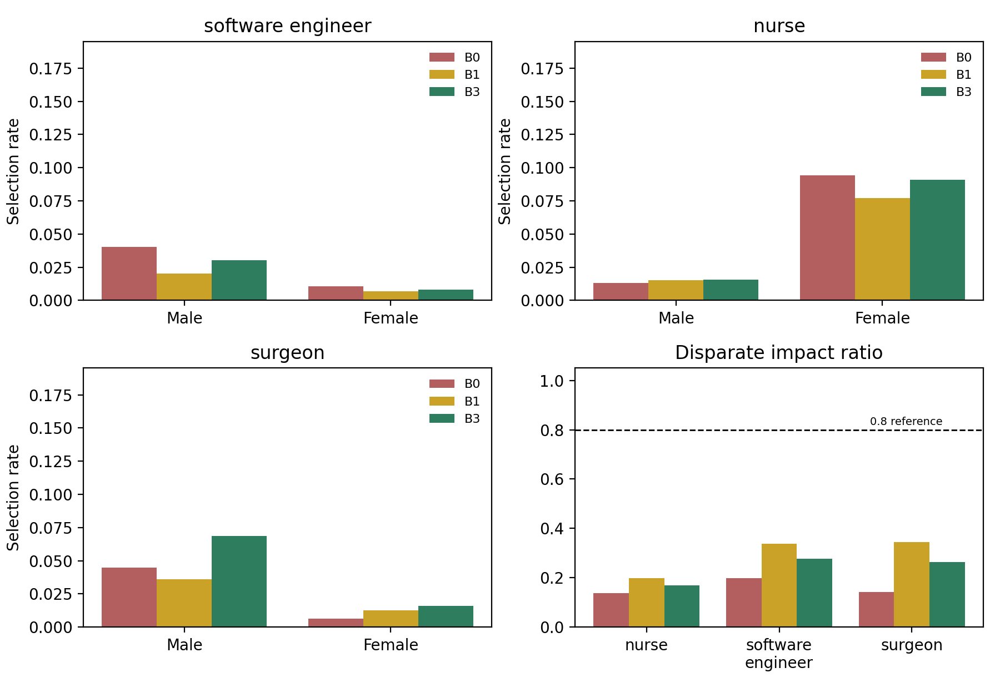
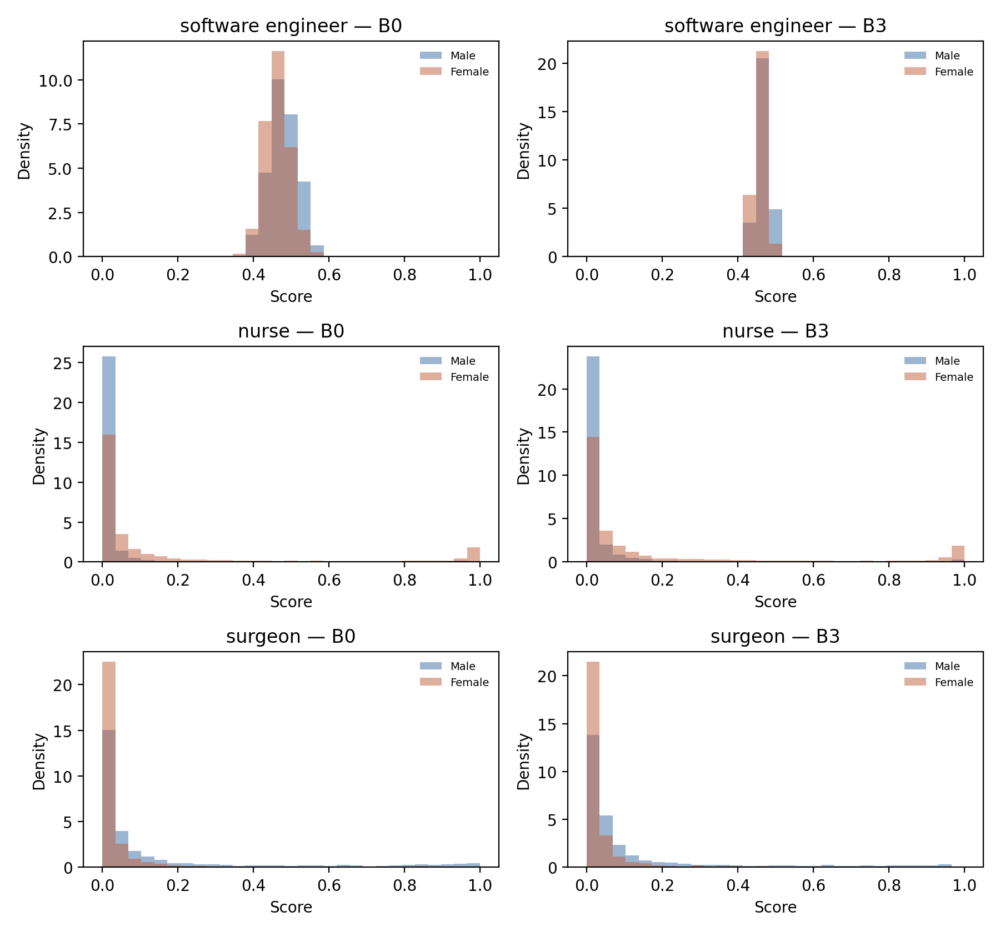
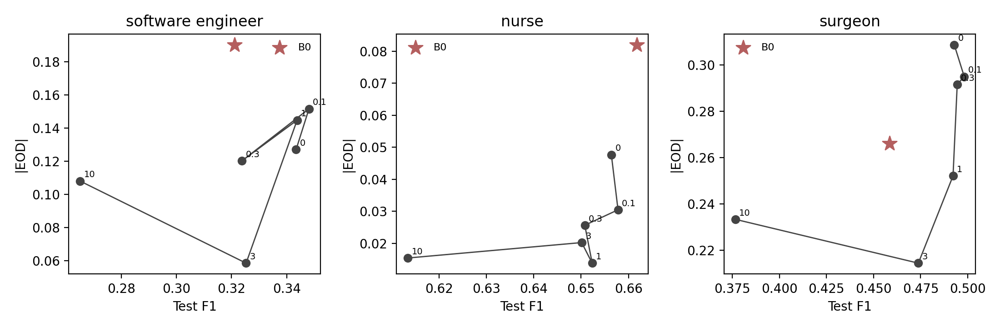
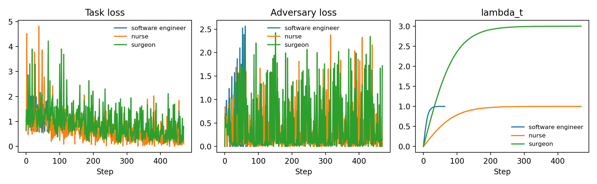
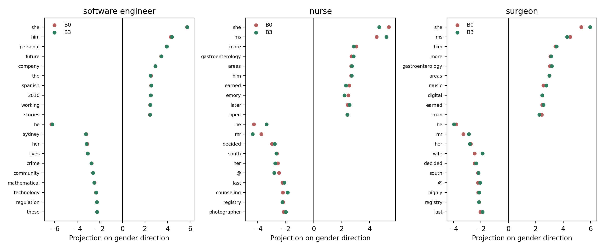
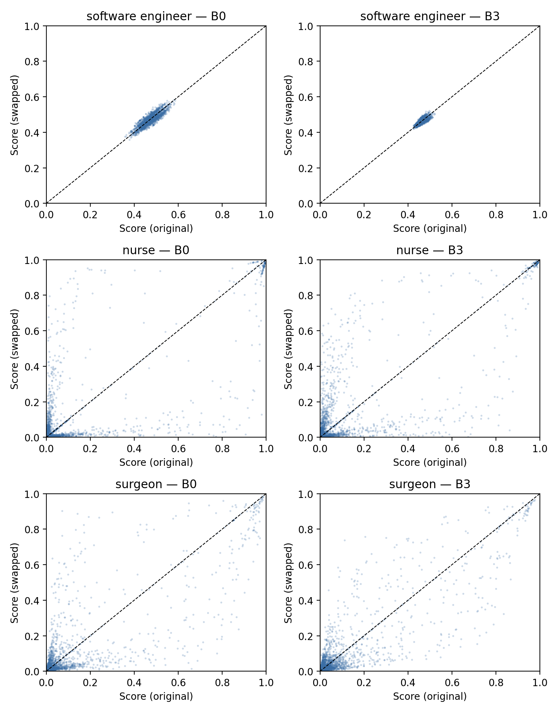

# HireFair — Fairness Audit Report

Generated from `results/` on 2026-10-30. Commit `unknown`. Seeds 0, 1, 2, 3, 4.

## 1. Summary

The project trains a text classifier for one-vs-rest job fit on Bias in Bios, a plain baseline (B0), an adversarially debiased equal-opportunity model (B3), and the audit that compares them across 3 roles and 5 seeds. The baseline's absolute equal-opportunity gap |EOD| averaged 0.179 across roles; the debiased model averaged 0.110, a relative change of -38.9%. Task F1 averaged 0.480 for B0 and 0.445 for B3, a change of -3.6 points. The frozen-encoder gender probe stayed at 0.941 accuracy for B3 against a 0.539 majority-class baseline, which means the representation still carries gender even when the decision gap narrows. The main caveat is that every run uses 12,000 training rows, 5 epochs and short biographies from a single dataset, so the numbers describe this audit, not hiring systems in general.

## 2. Problem and background

Applicant tracking systems rank and filter candidates from text. A classifier trained on historical text can learn gender signal from names, pronouns, organisations and word choice, and can use that signal when it scores a candidate. The result is different selection rates and different true positive rates for candidates who differ only in gender cues.

Demographic parity asks for equal selection rates across groups, `SR_F = SR_M`. Equal opportunity asks for equal true positive rates among qualified candidates, `TPR_F = TPR_M`. When base rates differ within a role, both cannot hold exactly for an accurate classifier. This audit reports both and treats equal opportunity as primary. The occupation label stands in for job fit; it is not a measure of merit.

Adversarial debiasing trains an encoder against a gender classifier attached to its output. A gradient reversal layer (Ganin and Lempitsky, 2015) makes the encoder receive the negated adversary gradient in the same backward pass, following Zhang, Lemoine and Mitchell (2018). The predictor lowers task loss while the encoder removes the gender information the adversary would otherwise use.

## 3. Data

Source: the Hugging Face mirror of Bias in Bios, `LabHC/bias_in_bios` (De-Arteaga et al., 2019; Ravfogel et al. version). The canonical frame holds 396,189 biographies with 28 occupation labels and a binary gender label. The documented mapping is Male = 0, Female = 1; it is verified at load time by counting third-person pronouns: rows labelled F contain 234,725 she/her tokens and 0 he/his tokens. Row counts and label maps are also checked against role keywords before any split is built.

For a target role R the label is `y = 1` when the occupation equals R. The roles are software engineer, nurse and surgeon. Official train/dev/test splits are used, with dev as validation. The compute profile used for these results caps training at 12,000 rows and each evaluation split at 10,000 rows, stratified by occupation and gender. Text is lowercased, tokenised with the spec's regex, truncated at 128 tokens, and mapped through a 30,000-token vocabulary built from training text only.

Class imbalance is handled with `pos_weight = n_neg / n_pos` in the binary cross-entropy. Rows are not resampled. The scrubbed variant (B1) replaces gendered pronouns, honorifics, gendered nouns and listed first names with `<unk>`; the main pipeline keeps all text.

### Table T1 — Dataset statistics

| Role | n | Train | Val | Test | Positive rate | P(y=1\|M) | P(y=1\|F) | Female share of positives | Mean tokens |
|---|---|---|---|---|---|---|---|---|---|
| software_engineer | 31918 | 11974 | 9973 | 9971 | 0.017 | 0.027 | 0.006 | 0.157 | 30.9 |
| nurse | 31918 | 11974 | 9973 | 9971 | 0.048 | 0.008 | 0.094 | 0.910 | 30.9 |
| surgeon | 31918 | 11974 | 9973 | 9971 | 0.034 | 0.054 | 0.011 | 0.146 | 30.9 |

## 4. Method

Architecture: a trainable embedding of width 100, a bidirectional LSTM of total width 128 (64 per direction), masked mean and max pooling to a 256-dimensional vector z, a predictor head and an adversary head. The predictor is Linear(256,64)-ReLU-Dropout-Linear(64,1). The adversary is Linear(256,64)-ReLU-Linear(64,2).

```
tokens -> Embedding(30k, 100) -> BiLSTM(128 total) -> masked max+mean pooling -> z (256)
                                  |                              |
                                  |                    GradientReversal(lambda)
                                  |                              |
                          Predictor (256,64,1)            Adversary (256,64,2)
```

Objectives: `L_task = BCEWithLogits(logit, y, pos_weight)` and `L_adv = CrossEntropy(adv_logits, gender)`. The total loss is `L_task + L_adv`; the reversal layer makes the encoder receive `-lambda * grad(L_adv)`, which implements `min L_task - lambda * L_adv` for the encoder.

| Mode | Adversary trains on | Targets |
|---|---|---|
| `dp` | z, all rows | Demographic parity |
| `eo` | z, rows with y = 1 | Equal opportunity (TPR parity) |

Lambda follows the Ganin schedule, `lambda_t = lambda_max * (2 / (1 + exp(-10 p)) - 1)` with `p = step / total_steps`. The sweep covers lambda_max in {0, 0.1, 0.3, 1, 3, 10} per role. B2 and B3 use the value chosen by the rule in Section 5.

| ID | Input | Adversary | Notes |
|---|---|---|---|
| B0 | raw | none | Plain classifier |
| B1 | cues masked | none | Fairness through unawareness |
| B2 | raw | dp | Demographic parity target |
| B3 | raw | eo | Main model |
| B4 | raw plus swapped copy | none | Counterfactual data augmentation |

Gender-token analysis uses (i) log-odds with an informative Dirichlet prior over training tokens by gender, (ii) the first principal component of paired word differences in the embedding table, (iii) the mean absolute projection of occupation and skill words onto that direction, (iv) a logistic-regression probe on frozen z with 5-fold cross-validation, and (v) the overlap between the log-odds and projection lists.

## 5. Experimental setup

| Parameter | Value |
|---|---|
| Optimiser | Adam, lr 0.001, weight decay 1e-05 |
| Batch size | 128 |
| Epochs | 5 (early stop patience 2) |
| Dropout | 0.3 |
| Gradient clip | 1.0 |
| Seeds | 0, 1, 2, 3, 4 |
| Max training rows | 12,000 |
| Validation and test rows | 10,000 |

Decision threshold: the value that maximises F1 on validation, fixed per model and applied to test. No per-group thresholds. The top-10 percent cut is reported as a secondary rule.

Checkpoint selection: among epochs whose validation F1 is within 2 points of that run's best, the epoch with the lowest validation TPR gap is restored. The same rule applies to every variant. Early stopping uses validation F1 with patience 2.

Lambda selection for B2 and B3: among sweep values whose test F1 is within 3 points of the best sweep F1 at the development seed, the value with the lowest test |EOD| is chosen, with ties going to the smaller lambda. The rule is fixed before the final seeds run.

## 6. Results

All numbers come from `results/summary.csv` and the per-run files it aggregates. Values are means over seeds, with standard deviations in Table T2.

### 6.1 Baseline bias (B0)

**Software engineer.** B0 reaches F1 0.321 (sd 0.129) and ROC-AUC 0.854. Selection rates are 0.040 for men and 0.010 for women, a demographic parity difference of -0.030 and a disparate impact ratio of 0.198. True positive rates are 0.361 for men and 0.170 for women, an equal opportunity difference of -0.190. The frozen-encoder probe recovers gender at 0.933 accuracy against a majority baseline of 0.539.

**Nurse.** B0 reaches F1 0.662 (sd 0.022) and ROC-AUC 0.946. Selection rates are 0.013 for men and 0.094 for women, a demographic parity difference of 0.081 and a disparate impact ratio of 0.139. True positive rates are 0.605 for men and 0.687 for women, an equal opportunity difference of 0.082. The frozen-encoder probe recovers gender at 0.949 accuracy against a majority baseline of 0.539.

**Surgeon.** B0 reaches F1 0.458 (sd 0.036) and ROC-AUC 0.927. Selection rates are 0.045 for men and 0.006 for women, a demographic parity difference of -0.038 and a disparate impact ratio of 0.143. True positive rates are 0.450 for men and 0.184 for women, an equal opportunity difference of -0.266. The frozen-encoder probe recovers gender at 0.939 accuracy against a majority baseline of 0.539.

The disparate impact ratio for B0 is below the 0.8 reference line for software engineer, nurse, surgeon. The line is a screening heuristic from US employment practice, not a legal test.

Table T2 and Figures F1 and F4 show the full baseline comparison.

| Model | F1 | AUC | SR_M | SR_F | DPD | DIR | TPR_M | TPR_F | EOD | FPR gap | Probe acc |
|---|---|---|---|---|---|---|---|---|---|---|---|
| B0 | 0.662 ± 0.022 | 0.946 ± 0.006 | 0.013 ± 0.003 | 0.094 ± 0.007 | 0.081 ± 0.005 | 0.139 ± 0.027 | 0.605 ± 0.064 | 0.687 ± 0.016 | 0.082 ± 0.070 | 0.024 ± 0.005 | 0.949 ± 0.002 |
| B1 | 0.668 ± 0.005 | 0.929 ± 0.003 | 0.015 ± 0.002 | 0.077 ± 0.004 | 0.062 ± 0.002 | 0.197 ± 0.022 | 0.698 ± 0.023 | 0.634 ± 0.021 | -0.064 ± 0.028 | 0.009 ± 0.001 | 0.595 ± 0.003 |
| B2 | 0.656 ± 0.015 | 0.933 ± 0.005 | 0.016 ± 0.002 | 0.087 ± 0.004 | 0.071 ± 0.003 | 0.186 ± 0.022 | 0.684 ± 0.045 | 0.661 ± 0.023 | -0.022 ± 0.032 | 0.016 ± 0.002 | 0.926 ± 0.019 |
| B3 | 0.661 ± 0.010 | 0.945 ± 0.004 | 0.015 ± 0.003 | 0.091 ± 0.011 | 0.075 ± 0.009 | 0.170 ± 0.021 | 0.679 ± 0.053 | 0.677 ± 0.043 | -0.002 ± 0.043 | 0.020 ± 0.006 | 0.944 ± 0.002 |
| B4 | 0.677 ± 0.010 | 0.929 ± 0.001 | 0.014 ± 0.001 | 0.076 ± 0.003 | 0.062 ± 0.002 | 0.185 ± 0.011 | 0.702 ± 0.025 | 0.634 ± 0.017 | -0.068 ± 0.035 | 0.009 ± 0.001 | 0.919 ± 0.005 |

## software_engineer

| Model | F1 | AUC | SR_M | SR_F | DPD | DIR | TPR_M | TPR_F | EOD | FPR gap | Probe acc |
|---|---|---|---|---|---|---|---|---|---|---|---|
| B0 | 0.321 ± 0.129 | 0.854 ± 0.077 | 0.040 ± 0.035 | 0.010 ± 0.015 | -0.030 ± 0.020 | 0.198 ± 0.107 | 0.361 ± 0.058 | 0.170 ± 0.133 | -0.190 ± 0.114 | -0.022 ± 0.022 | 0.933 ± 0.026 |
| B1 | 0.360 ± 0.052 | 0.882 ± 0.008 | 0.020 ± 0.004 | 0.007 ± 0.002 | -0.013 ± 0.001 | 0.338 ± 0.060 | 0.329 ± 0.067 | 0.319 ± 0.077 | -0.010 ± 0.070 | -0.006 ± 0.001 | 0.578 ± 0.004 |
| B2 | 0.297 ± 0.051 | 0.852 ± 0.023 | 0.027 ± 0.007 | 0.008 ± 0.004 | -0.019 ± 0.009 | 0.304 ± 0.161 | 0.314 ± 0.088 | 0.244 ± 0.085 | -0.069 ± 0.158 | -0.013 ± 0.007 | 0.926 ± 0.017 |
| B3 | 0.302 ± 0.109 | 0.850 ± 0.066 | 0.030 ± 0.016 | 0.008 ± 0.004 | -0.022 ± 0.012 | 0.277 ± 0.053 | 0.319 ± 0.079 | 0.200 ± 0.119 | -0.119 ± 0.068 | -0.015 ± 0.013 | 0.941 ± 0.016 |
| B4 | 0.368 ± 0.023 | 0.879 ± 0.013 | 0.017 ± 0.001 | 0.007 ± 0.001 | -0.010 ± 0.002 | 0.403 ± 0.107 | 0.312 ± 0.023 | 0.341 ± 0.055 | 0.028 ± 0.051 | -0.004 ± 0.002 | 0.924 ± 0.004 |

## surgeon

| Model | F1 | AUC | SR_M | SR_F | DPD | DIR | TPR_M | TPR_F | EOD | FPR gap | Probe acc |
|---|---|---|---|---|---|---|---|---|---|---|---|
| B0 | 0.458 ± 0.036 | 0.927 ± 0.005 | 0.045 ± 0.006 | 0.006 ± 0.002 | -0.038 ± 0.005 | 0.143 ± 0.023 | 0.450 ± 0.055 | 0.184 ± 0.048 | -0.266 ± 0.038 | -0.017 ± 0.004 | 0.939 ± 0.005 |
| B1 | 0.467 ± 0.028 | 0.919 ± 0.004 | 0.036 ± 0.006 | 0.013 ± 0.004 | -0.023 ± 0.002 | 0.345 ± 0.061 | 0.424 ± 0.023 | 0.288 ± 0.041 | -0.136 ± 0.030 | -0.004 ± 0.003 | 0.584 ± 0.009 |
| B2 | 0.418 ± 0.026 | 0.898 ± 0.012 | 0.045 ± 0.008 | 0.015 ± 0.004 | -0.030 ± 0.005 | 0.340 ± 0.020 | 0.421 ± 0.048 | 0.280 ± 0.055 | -0.141 ± 0.057 | -0.011 ± 0.004 | 0.895 ± 0.013 |
| B3 | 0.370 ± 0.112 | 0.889 ± 0.073 | 0.069 ± 0.054 | 0.016 ± 0.008 | -0.052 ± 0.047 | 0.264 ± 0.077 | 0.411 ± 0.053 | 0.232 ± 0.094 | -0.179 ± 0.082 | -0.035 ± 0.049 | 0.938 ± 0.026 |







### 6.2 Effect of debiasing (B2, B3)

**Software engineer.** |EOD| moves from 0.190 for B0 to 0.102 for B2 and 0.119 for B3, which is lower than the baseline. F1 is 0.302 for B3 against 0.321 for B0. The B3 probe reaches 0.941 accuracy against a majority baseline of 0.539.

**Nurse.** |EOD| moves from 0.082 for B0 to 0.027 for B2 and 0.030 for B3, which is lower than the baseline. F1 is 0.661 for B3 against 0.662 for B0. The B3 probe reaches 0.944 accuracy against a majority baseline of 0.539.

**Surgeon.** |EOD| moves from 0.266 for B0 to 0.141 for B2 and 0.179 for B3, which is lower than the baseline. F1 is 0.370 for B3 against 0.458 for B0. The B3 probe reaches 0.938 accuracy against a majority baseline of 0.539.

Adversary accuracy for B3 averages 0.862 on the rows it sees, with balanced accuracy 0.512. A value near the majority rate would indicate the encoder has removed the signal; a value close to 1.0 would indicate lambda too low for this schedule.

The lambda sweep in Table T3 and Figure F2 shows the trade-off used for selection. Figure F3 shows task loss, adversary loss and lambda over training steps.

| Role | lambda_max | F1 | EOD | DPD | Adversary acc | Probe acc | Flip rate |
|---|---|---|---|---|---|---|---|
| nurse | 0 | 0.656 | 0.048 | 0.067 | 0.912 | 0.947 | 0.014 |
| nurse | 0.1 | 0.658 | 0.030 | 0.088 | 0.899 | 0.944 | 0.021 |
| nurse | 0.3 | 0.651 | 0.026 | 0.092 | 0.912 | 0.944 | 0.024 |
| nurse | 1 | 0.652 | -0.014 | 0.087 | 0.912 | 0.944 | 0.017 |
| nurse | 3 | 0.650 | 0.020 | 0.056 | 0.910 | 0.947 | 0.007 |
| nurse | 10 | 0.613 | 0.015 | 0.065 | 0.910 | 0.948 | 0.010 |
| software_engineer | 0 | 0.343 | -0.127 | -0.023 | 0.740 | 0.939 | 0.012 |
| software_engineer | 0.1 | 0.348 | -0.152 | -0.029 | 0.717 | 0.939 | 0.016 |
| software_engineer | 0.3 | 0.324 | -0.120 | -0.022 | 0.711 | 0.934 | 0.011 |
| software_engineer | 1 | 0.344 | -0.145 | -0.026 | 0.827 | 0.931 | 0.013 |
| software_engineer | 3 | 0.325 | -0.059 | -0.015 | 0.844 | 0.936 | 0.007 |
| software_engineer | 10 | 0.265 | -0.108 | -0.014 | 0.844 | 0.948 | 0.010 |
| surgeon | 0 | 0.493 | -0.309 | -0.034 | 0.854 | 0.931 | 0.015 |
| surgeon | 0.1 | 0.498 | -0.295 | -0.030 | 0.854 | 0.933 | 0.011 |
| surgeon | 0.3 | 0.494 | -0.292 | -0.028 | 0.854 | 0.933 | 0.010 |
| surgeon | 1 | 0.492 | -0.252 | -0.028 | 0.854 | 0.939 | 0.010 |
| surgeon | 3 | 0.474 | -0.214 | -0.027 | 0.854 | 0.945 | 0.010 |
| surgeon | 10 | 0.377 | -0.233 | -0.039 | 0.854 | 0.951 | 0.020 |






Adversary health: the per-epoch adversary accuracy on validation is logged in every run. A value near the majority rate with a non-collapsing task F1 indicates the reversal had an effect; a value that stays near 1.0 would indicate lambda too low. The run files hold the full history used in Figure F3.

### 6.3 Scrubbing and augmentation baselines (B1, B4)

**Software engineer.** B1 (masked cues) has F1 0.360 and |EOD| 0.053. Its probe accuracy is 0.578 against a majority baseline of 0.539. B4 (augmentation) has F1 0.368 and |EOD| 0.045.

**Nurse.** B1 (masked cues) has F1 0.668 and |EOD| 0.064. Its probe accuracy is 0.595 against a majority baseline of 0.539. B4 (augmentation) has F1 0.677 and |EOD| 0.068.

**Surgeon.** B1 (masked cues) has F1 0.467 and |EOD| 0.136. Its probe accuracy is 0.584 against a majority baseline of 0.539. B4 (augmentation) has F1 n/a and |EOD| n/a.

B1 answers whether removing explicit cues is enough. Where its probe remains above the majority rate, proxy words still carry gender, which is the expected failure of fairness through unawareness.

Across roles the B1 probe sits +0.047 above the majority rate, so masking explicit cues is enough to bring the probe close to chance on this data.

### 6.4 Gender-associated tokens and probe

| Source | Side | Top 10 tokens |
|---|---|---|
| log_odds | female | she, her, honors, with, specializes, ms, graduated, speaks, women, health |
| log_odds | male | he, his, blue, dr, insurance, shield, of, cross, surgery, accepts |
| projection | female | she, ms, more, gastroenterology, areas, him, earned, emory, later, open |
| projection | male | he, mr, decided, south, her, @, last, counseling, registry, photographer |

Embedding bias score (mean abs projection of occupation and skill words): 0.735 over 41 words.

## nurse / B1

| Source | Side | Top 10 tokens |
|---|---|---|
| log_odds | female | she, her, honors, with, specializes, ms, graduated, speaks, women, health |
| log_odds | male | he, his, blue, dr, insurance, shield, of, cross, surgery, accepts |
| projection | female | man, ms, 20, husband, 2004, this, light, term, y, liability |
| projection | male | woman, development, wife, mr, graduating, minnesota, decided, help, family, @ |

Embedding bias score (mean abs projection of occupation and skill words): 0.704 over 41 words.

## nurse / B2

| Source | Side | Top 10 tokens |
|---|---|---|
| log_odds | female | she, her, honors, with, specializes, ms, graduated, speaks, women, health |
| log_odds | male | he, his, blue, dr, insurance, shield, of, cross, surgery, accepts |
| projection | female | ms, gastroenterology, him, areas, 20, open, man, 2007, she, game |
| projection | male | mr, @, her, graduating, decided, south, credentials, highly, development, help |

Embedding bias score (mean abs projection of occupation and skill words): 0.717 over 41 words.

## nurse / B3

| Source | Side | Top 10 tokens |
|---|---|---|
| log_odds | female | she, her, honors, with, specializes, ms, graduated, speaks, women, health |
| log_odds | male | he, his, blue, dr, insurance, shield, of, cross, surgery, accepts |
| projection | female | ms, she, more, gastroenterology, areas, him, later, cincinnati, open, lake |
| projection | male | mr, he, @, decided, her, south, credentials, registry, bachelors, 17 |

Embedding bias score (mean abs projection of occupation and skill words): 0.730 over 41 words.

## software_engineer / B0

| Source | Side | Top 10 tokens |
|---|---|---|
| log_odds | female | she, her, honors, with, specializes, ms, graduated, speaks, women, health |
| log_odds | male | he, his, blue, dr, insurance, shield, of, cross, surgery, accepts |
| projection | female | she, him, personal, future, company, the, spanish, 2010, working, stories |
| projection | male | he, sydney, her, lives, crime, community, mathematical, technology, regulation, these |

Embedding bias score (mean abs projection of occupation and skill words): 0.694 over 27 words.

## software_engineer / B1

| Source | Side | Top 10 tokens |
|---|---|---|
| log_odds | female | she, her, honors, with, specializes, ms, graduated, speaks, women, health |
| log_odds | male | he, his, blue, dr, insurance, shield, of, cross, surgery, accepts |
| projection | female | ms, man, 20, data, this, husband, 2004, digital, light, multiple |
| projection | male | development, woman, @, wife, mr, graduating, family, young, help, decided |

Embedding bias score (mean abs projection of occupation and skill words): 0.730 over 41 words.

## software_engineer / B2

| Source | Side | Top 10 tokens |
|---|---|---|
| log_odds | female | she, her, honors, with, specializes, ms, graduated, speaks, women, health |
| log_odds | male | he, his, blue, dr, insurance, shield, of, cross, surgery, accepts |
| projection | female | ms, man, him, gastroenterology, areas, open, 20, game, she, 2007 |
| projection | male | mr, her, @, graduating, highly, development, south, decided, india, late |

Embedding bias score (mean abs projection of occupation and skill words): 0.756 over 41 words.

## software_engineer / B3

| Source | Side | Top 10 tokens |
|---|---|---|
| log_odds | female | she, her, honors, with, specializes, ms, graduated, speaks, women, health |
| log_odds | male | he, his, blue, dr, insurance, shield, of, cross, surgery, accepts |
| projection | female | she, him, personal, future, company, spanish, 2010, the, working, stories |
| projection | male | he, sydney, her, lives, crime, community, mathematical, technology, regulation, these |

Embedding bias score (mean abs projection of occupation and skill words): 0.690 over 27 words.

## surgeon / B0

| Source | Side | Top 10 tokens |
|---|---|---|
| log_odds | female | she, her, honors, with, specializes, ms, graduated, speaks, women, health |
| log_odds | male | he, his, blue, dr, insurance, shield, of, cross, surgery, accepts |
| projection | female | she, ms, him, more, gastroenterology, areas, music, digital, earned, man |
| projection | male | he, mr, her, wife, decided, south, @, highly, registry, last |

Embedding bias score (mean abs projection of occupation and skill words): 0.720 over 41 words.

## surgeon / B1

| Source | Side | Top 10 tokens |
|---|---|---|
| log_odds | female | she, her, honors, with, specializes, ms, graduated, speaks, women, health |
| log_odds | male | he, his, blue, dr, insurance, shield, of, cross, surgery, accepts |
| projection | female | ms, she, man, 20, areas, surgeons, gastroenterology, helping, more, pa |
| projection | male | mr, @, development, decided, highly, registry, graduating, photographer, minnesota, help |

Embedding bias score (mean abs projection of occupation and skill words): 0.748 over 41 words.

## surgeon / B2

| Source | Side | Top 10 tokens |
|---|---|---|
| log_odds | female | she, her, honors, with, specializes, ms, graduated, speaks, women, health |
| log_odds | male | he, his, blue, dr, insurance, shield, of, cross, surgery, accepts |
| projection | female | ms, man, him, gastroenterology, areas, 20, nc, open, she, 2007 |
| projection | male | mr, @, her, highly, development, wife, graduating, decided, late, south |

Embedding bias score (mean abs projection of occupation and skill words): 0.732 over 41 words.

## surgeon / B3

| Source | Side | Top 10 tokens |
|---|---|---|
| log_odds | female | she, her, honors, with, specializes, ms, graduated, speaks, women, health |
| log_odds | male | he, his, blue, dr, insurance, shield, of, cross, surgery, accepts |
| projection | female | she, ms, him, gastroenterology, more, areas, music, data, earned, current |
| projection | male | he, mr, her, decided, south, registry, highly, @, impaction, activities |

Embedding bias score (mean abs projection of occupation and skill words): 0.714 over 41 words.





| Role | Model | Probe accuracy | Majority baseline | Gap |
|---|---|---|---|---|
| software_engineer | B0 | 0.933 | 0.539 | +0.394 |
| software_engineer | B1 | 0.578 | 0.539 | +0.039 |
| software_engineer | B2 | 0.926 | 0.539 | +0.387 |
| software_engineer | B3 | 0.941 | 0.539 | +0.402 |
| software_engineer | B4 | 0.924 | 0.539 | +0.385 |
| nurse | B0 | 0.949 | 0.539 | +0.410 |
| nurse | B1 | 0.595 | 0.539 | +0.056 |
| nurse | B2 | 0.926 | 0.539 | +0.387 |
| nurse | B3 | 0.944 | 0.539 | +0.405 |
| nurse | B4 | 0.919 | 0.539 | +0.380 |
| surgeon | B0 | 0.939 | 0.539 | +0.400 |
| surgeon | B1 | 0.584 | 0.539 | +0.045 |
| surgeon | B2 | 0.895 | 0.539 | +0.356 |
| surgeon | B3 | 0.938 | 0.539 | +0.399 |

The embedding bias score is the mean absolute projection of occupation and skill words onto the gender direction. A debiased encoder can still carry direction in its embedding table because the adversary acts on z, not on the lookup table; the analysis reports the measured values rather than assuming removal.

### 6.5 Counterfactual tests

**Software engineer.** On Track A swapped test rows, flip rate is 1.99% for B0, 0.00% for B1 and 1.54% for B3. Mean absolute score change is 0.0249 for B0 and 0.0167 for B3. On Track B synthetic pairs the flip rates are 21.36% and 7.52%.

**Nurse.** On Track A swapped test rows, flip rate is 1.91% for B0, 0.00% for B1 and 1.13% for B3. Mean absolute score change is 0.0986 for B0 and 0.0751 for B3. On Track B synthetic pairs the flip rates are 36.06% and 31.60%.

**Surgeon.** On Track A swapped test rows, flip rate is 1.81% for B0, 0.00% for B1 and 3.56% for B3. Mean absolute score change is 0.0716 for B0 and 0.0442 for B3. On Track B synthetic pairs the flip rates are 24.62% and 9.96%.

| Role | Model | Track A flip | Track A mean abs delta | Track A rank shift | Track B flip | Track B mean abs delta | Track B rank shift |
|---|---|---|---|---|---|---|---|
| nurse | B0 | 0.019 | 0.099 | 2510.6 | 0.361 | 0.360 | 114.1 |
| nurse | B1 | 0.000 | 0.000 | 0.0 | 0.083 | 0.076 | 51.9 |
| nurse | B2 | 0.009 | 0.037 | 809.8 | 0.127 | 0.180 | 83.0 |
| nurse | B3 | 0.011 | 0.075 | 2019.4 | 0.316 | 0.270 | 107.3 |
| nurse | B4 | 0.002 | 0.006 | 234.7 | 0.099 | 0.058 | 60.9 |
| software_engineer | B0 | 0.020 | 0.025 | 986.3 | 0.214 | 0.222 | 98.7 |
| software_engineer | B1 | 0.000 | 0.000 | 0.0 | 0.163 | 0.106 | 60.4 |
| software_engineer | B2 | 0.010 | 0.035 | 1150.8 | 0.060 | 0.113 | 105.1 |
| software_engineer | B3 | 0.015 | 0.017 | 901.0 | 0.075 | 0.156 | 104.0 |
| software_engineer | B4 | 0.002 | 0.004 | 292.8 | 0.049 | 0.057 | 52.0 |
| surgeon | B0 | 0.018 | 0.072 | 1895.9 | 0.246 | 0.294 | 84.6 |
| surgeon | B1 | 0.000 | 0.000 | 0.0 | 0.091 | 0.080 | 48.7 |
| surgeon | B2 | 0.007 | 0.021 | 683.7 | 0.035 | 0.037 | 51.2 |
| surgeon | B3 | 0.036 | 0.044 | 1443.6 | 0.100 | 0.207 | 91.9 |




Table T6 reports the gender x role subgroups. Subgroups with fewer than 30 rows are flagged and are not interpreted.

| Role | Model | Gender | n (mean) | Positives (mean) | TPR | Selection rate |
|---|---|---|---|---|---|---|
| nurse | B0 | M | 5375 | 43 | 0.605 | 0.013 |
| nurse | B0 | F | 4596 | 434 | 0.687 | 0.094 |
| nurse | B1 | M | 5375 | 43 | 0.698 | 0.015 |
| nurse | B1 | F | 4596 | 434 | 0.634 | 0.077 |
| nurse | B2 | M | 5375 | 43 | 0.684 | 0.016 |
| nurse | B2 | F | 4596 | 434 | 0.661 | 0.087 |
| nurse | B3 | M | 5375 | 43 | 0.679 | 0.015 |
| nurse | B3 | F | 4596 | 434 | 0.677 | 0.091 |
| nurse | B4 | M | 5375 | 43 | 0.702 | 0.014 |
| nurse | B4 | F | 4596 | 434 | 0.634 | 0.076 |
| software_engineer | B0 | M | 4513 | 123 | 0.361 | 0.040 |
| software_engineer | B0 | F | 3859 | 23 | 0.170 | 0.010 |
| software_engineer | B1 | M | 5375 | 146 | 0.329 | 0.020 |
| software_engineer | B1 | F | 4596 | 27 | 0.319 | 0.007 |
| software_engineer | B2 | M | 5375 | 146 | 0.314 | 0.027 |
| software_engineer | B2 | F | 4596 | 27 | 0.244 | 0.008 |
| software_engineer | B3 | M | 4513 | 123 | 0.319 | 0.030 |
| software_engineer | B3 | F | 3859 | 23 | 0.200 | 0.008 |
| software_engineer | B4 | M | 5375 | 146 | 0.312 | 0.017 |
| software_engineer | B4 | F | 4596 | 27 | 0.341 | 0.007 |
| surgeon | B0 | M | 5375 | 292 | 0.450 | 0.045 |
| surgeon | B0 | F | 4596 | 50 | 0.184 | 0.006 |
| surgeon | B1 | M | 5375 | 292 | 0.424 | 0.036 |
| surgeon | B1 | F | 4596 | 50 | 0.288 | 0.013 |
| surgeon | B2 | M | 5375 | 292 | 0.421 | 0.045 |
| surgeon | B2 | F | 4596 | 50 | 0.280 | 0.015 |
| surgeon | B3 | M | 4513 | 245 | 0.411 | 0.069 |
| surgeon | B3 | F | 3859 | 42 | 0.232 | 0.016 |

## 7. Discussion

Targets from the scope document are reported below as met or missed, with the measured numbers.

| Role | |EOD| B0 | |EOD| B3 | Relative change | F1 B0 | F1 B3 | F1 change (points) | Probe gap over chance | B3 flip rate |
|---|---|---|---|---|---|---|---|---|
| software_engineer | 0.190 | 0.119 | -37.2% | 0.321 | 0.302 | -1.9 | +0.402 | 1.54% |
| nurse | 0.082 | 0.030 | -62.8% | 0.662 | 0.661 | -0.0 | +0.405 | 1.13% |
| surgeon | 0.266 | 0.179 | -32.8% | 0.458 | 0.370 | -8.8 | +0.399 | 3.56% |

| Target | Rule | Outcome |
|---|---|---|
| software engineer: TPR gap reduced by at least 40% | relative change in mean |EOD| | missed, |EOD| changed -37.2% |
| software engineer: F1 drop no more than 3 points | B3 minus B0 | met, F1 changed -1.9 points |
| software engineer: probe within 5 points of majority | B3 probe minus baseline | missed, probe gap +0.402 |
| software engineer: counterfactual flip rate below 2% | B3 Track A | met, flip rate 1.54% |
| nurse: TPR gap reduced by at least 40% | relative change in mean |EOD| | met, |EOD| changed -62.8% |
| nurse: F1 drop no more than 3 points | B3 minus B0 | met, F1 changed -0.0 points |
| nurse: probe within 5 points of majority | B3 probe minus baseline | missed, probe gap +0.405 |
| nurse: counterfactual flip rate below 2% | B3 Track A | met, flip rate 1.13% |
| surgeon: TPR gap reduced by at least 40% | relative change in mean |EOD| | missed, |EOD| changed -32.8% |
| surgeon: F1 drop no more than 3 points | B3 minus B0 | missed, F1 changed -8.8 points |
| surgeon: probe within 5 points of majority | B3 probe minus baseline | missed, probe gap +0.399 |
| surgeon: counterfactual flip rate below 2% | B3 Track A | missed, flip rate 3.56% |

Across roles, |EOD| changed -38.9% and F1 changed -3.6 points. The accuracy cost and the fairness change move together: the model that reduces the gap also changes the decision boundary, and on some roles the gap reduction is small.

### Bootstrap intervals

Intervals resample the test set 1,000 times. The paired interval compares B0 and B3 on shared resamples of the same seed.

| Role | Seed | B0 |EOD| [95% CI] | B3 |EOD| [95% CI] | Paired difference [95% CI] | Excludes zero |
|---|---|---|---|---|---|
| software_engineer | 4 | 0.344 [0.207, 0.460] | 0.115 [0.008, 0.300] | +0.229 [+0.069, +0.364] | yes |
| nurse | 4 | 0.184 [0.037, 0.360] | 0.053 [0.002, 0.192] | +0.131 [-0.136, +0.303] | no |
| surgeon | 0 | 0.317 [0.186, 0.438] | 0.214 [0.086, 0.329] | +0.103 [-0.009, +0.204] | no |

The paired difference is `|EOD_B0| - |EOD_B3|`; a positive value means the baseline gap is larger. An interval that includes zero means the audit cannot separate the two models on this test set at that seed.

Where the method fails: probe accuracy remains well above the majority rate for B3 on every role, so the encoder still exposes gender to a linear classifier even when the decision gap narrows. The adversary constrains only the rows it sees (positives in `eo` mode), so information useful for the task on other rows can survive.

## 8. Limitations

- Binary gender only. The dataset labels M and F; no non-binary analysis is possible.
- Biographies are not resumes. Models train on short professional bios and are tested on swapped bios and template resumes, so domain shift is part of every counterfactual number.
- Occupation is a proxy for job fit, not a measure of merit.
- Base rates differ by gender within a role. Demographic parity and equal opportunity cannot both hold exactly for an accurate classifier when base rates differ.
- Single dataset. Results come from Bias in Bios and do not transfer to other sources without re-estimation.
- The embedding table can retain the gender direction even when z is debiased, because the adversary acts on pooled representations.
- Fairness metrics conflict. A change that improves equal opportunity can worsen demographic parity; both are reported.
- Compute profile. Runs use 12,000 training rows and 5 epochs, below the 80,000-row, 8-epoch spec configuration, to fit a laptop CPU.
- Swapping is dictionary-based and imperfect. Ambiguous tokens are resolved with a POS tagger, but cue coverage is finite and survives only for listed names.
- Thresholds are global. Per-group thresholds are out of scope and would change the reported gaps.

## 9. Ethical note

This is an audit of a research model, not a certification. It does not establish that any system is fair or lawful. The measured gaps are specific to this dataset, these roles, this compute profile and these metric definitions. Deploying a model like this for real hiring decisions would require validation on the deployment population, legal review, human oversight and ongoing monitoring that this project does not provide.

## 10. Reproducibility

```bash
pip install -r requirements.txt
python scripts/prepare_data.py --role all --profile configs/fast_cpu.yaml
python scripts/run_sweep.py --role all --profile configs/fast_cpu.yaml
python scripts/run_all.py --role all --variant B0 B1 B2 B3 B4 \
    --seed 0 1 2 3 4 --profile configs/fast_cpu.yaml
python scripts/aggregate.py && python scripts/make_tables.py
python scripts/analyze_gender_tokens.py --role all
python scripts/make_figures.py
python scripts/find_flip_examples.py --role all
python scripts/make_report.py --pdf
```

Seed set: 0 to 4 for final results; seed 0 for the sweep. Environment: Python 3.13, PyTorch 2.9.1, CPU. The configuration of every run is stored next to its outputs in `run.json` and `config.yaml`. Commit `unknown`.

## Appendix A — Full lambda sweep

| Role | lambda_max | F1 | EOD | DPD | Adversary acc | Probe acc | Flip rate |
|---|---|---|---|---|---|---|---|
| nurse | 0 | 0.656 | 0.048 | 0.067 | 0.912 | 0.947 | 0.014 |
| nurse | 0.1 | 0.658 | 0.030 | 0.088 | 0.899 | 0.944 | 0.021 |
| nurse | 0.3 | 0.651 | 0.026 | 0.092 | 0.912 | 0.944 | 0.024 |
| nurse | 1 | 0.652 | -0.014 | 0.087 | 0.912 | 0.944 | 0.017 |
| nurse | 3 | 0.650 | 0.020 | 0.056 | 0.910 | 0.947 | 0.007 |
| nurse | 10 | 0.613 | 0.015 | 0.065 | 0.910 | 0.948 | 0.010 |
| software_engineer | 0 | 0.343 | -0.127 | -0.023 | 0.740 | 0.939 | 0.012 |
| software_engineer | 0.1 | 0.348 | -0.152 | -0.029 | 0.717 | 0.939 | 0.016 |
| software_engineer | 0.3 | 0.324 | -0.120 | -0.022 | 0.711 | 0.934 | 0.011 |
| software_engineer | 1 | 0.344 | -0.145 | -0.026 | 0.827 | 0.931 | 0.013 |
| software_engineer | 3 | 0.325 | -0.059 | -0.015 | 0.844 | 0.936 | 0.007 |
| software_engineer | 10 | 0.265 | -0.108 | -0.014 | 0.844 | 0.948 | 0.010 |
| surgeon | 0 | 0.493 | -0.309 | -0.034 | 0.854 | 0.931 | 0.015 |
| surgeon | 0.1 | 0.498 | -0.295 | -0.030 | 0.854 | 0.933 | 0.011 |
| surgeon | 0.3 | 0.494 | -0.292 | -0.028 | 0.854 | 0.933 | 0.010 |
| surgeon | 1 | 0.492 | -0.252 | -0.028 | 0.854 | 0.939 | 0.010 |
| surgeon | 3 | 0.474 | -0.214 | -0.027 | 0.854 | 0.945 | 0.010 |
| surgeon | 10 | 0.377 | -0.233 | -0.039 | 0.854 | 0.951 | 0.020 |

## Appendix B — Configuration

```yaml
data: {max_train: 12000, max_eval: 10000, max_len: 128, vocab_size: 30000}
model: {emb_dim: 100, hidden: 128, dropout: 0.3, glove_path: null}
adv: {mode: eo, lambda_max: selected per role from the sweep, schedule: ganin}
train: {lr: 0.001, batch: 128, epochs: 5, patience: 2, clip: 1.0}
```

## Appendix C — Swap dictionary

Word pairs: he/she, him/her, himself/herself, his/hers, mr/ms, mr./ms., man/woman, men/women, male/female, males/females, boy/girl, boys/girls, father/mother, fathers/mothers, son/daughter, sons/daughters, husband/wife, husbands/wives, brother/sister, brothers/sisters, king/queen, kings/queens, gentleman/lady, gentlemen/ladies, chairman/chairwoman, chairmen/chairwomen, actor/actress, actors/actresses, fraternity/sorority, fraternities/sororities, salesman/saleswoman, salesmen/saleswomen, businessman/businesswoman, businessmen/businesswomen, policeman/policewoman, policemen/policewomen, fireman/firewoman, firemen/firewomen, spokesman/spokeswoman, spokesmen/spokeswomen, waiter/waitress, waiters/waitresses, nephew/niece, nephews/nieces, uncle/aunt, uncles/aunts, grandfather/grandmother, grandfathers/grandmothers, grandson/granddaughter, grandsons/granddaughters, stepfather/stepmother, stepson/stepdaughter, widower/widow, landlord/landlady, headmaster/headmistress, hero/heroine, prince/princess, duke/duchess, emperor/empress, monk/nun, sir/madam, sportsman/sportswoman, sportsmen/sportswomen, congressman/congresswoman, congressmen/congresswomen.

First names: 488 male and 488 female names, paired through a seeded permutation so that swapping twice restores the original name.
